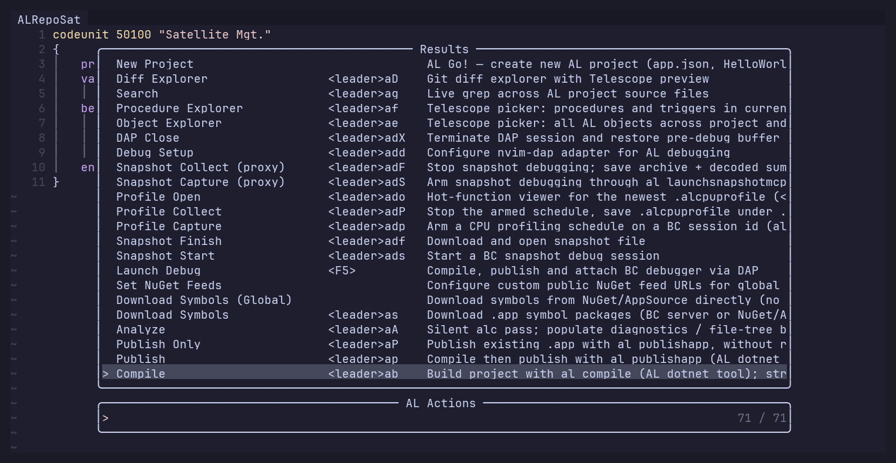
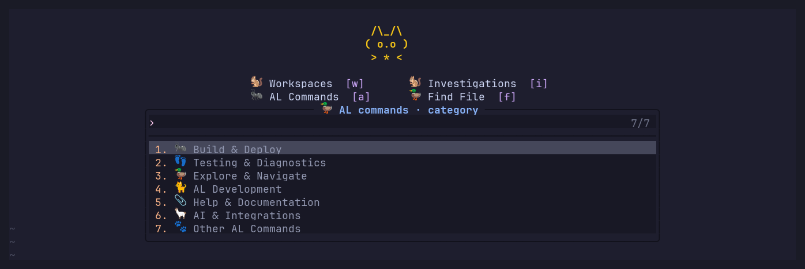
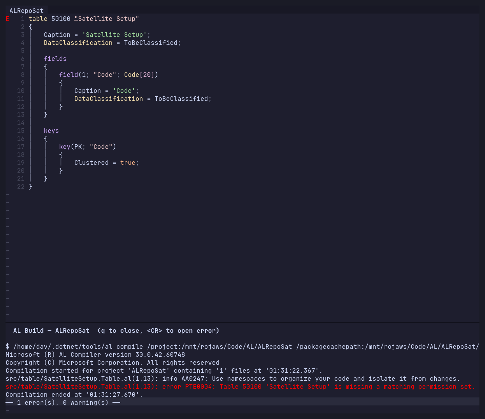
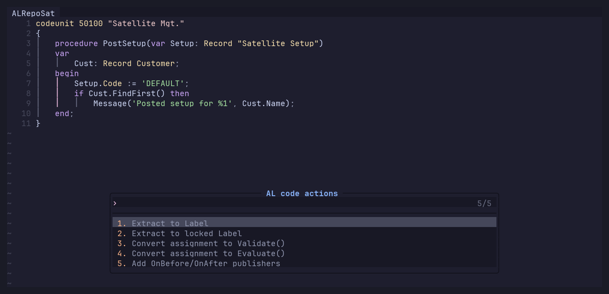
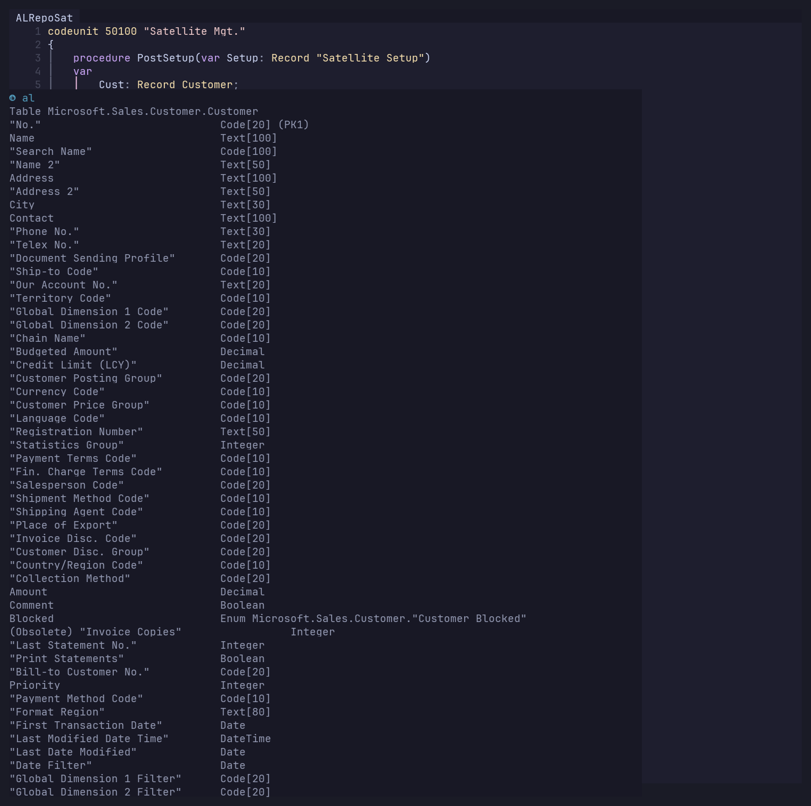
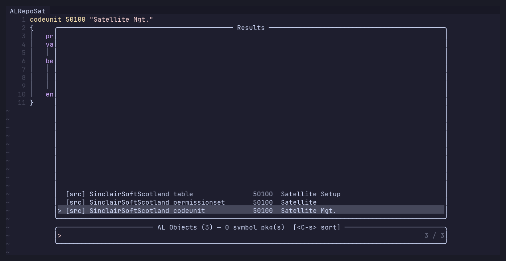
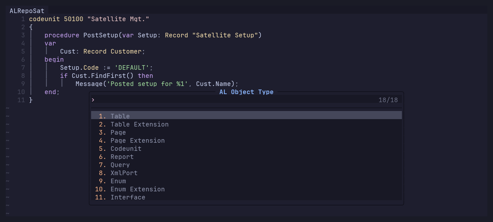
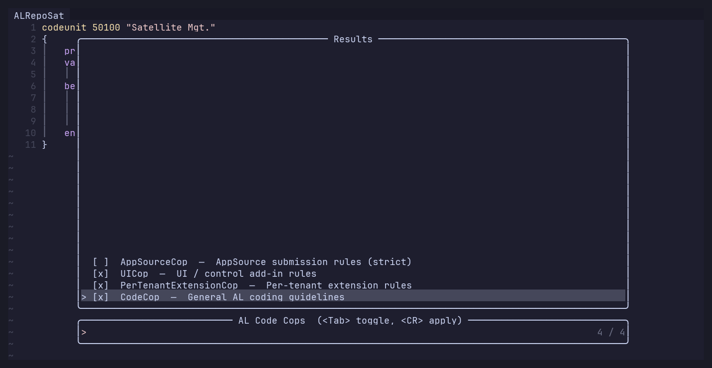
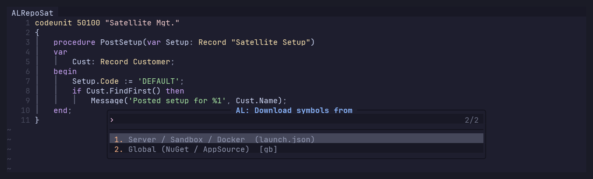

# ALNvim

> Business Central AL development in Neovim 0.11+. The AL dotnet tool is the toolchain. No VS Code required.

| Read | For |
|---|---|
| [docs/handbook.md](docs/handbook.md) | Why the plugin has this shape, status, design, sharp edges, maintenance |
| [docs/cheatsheet.md](docs/cheatsheet.md) | Every key and command |
| [docs/pi-setup.md](docs/pi-setup.md) | Pi agent setup per machine |
| [CLAUDE.md](CLAUDE.md) | Agent-facing rules, the densest reference |

## What it does

- Compiles, publishes, downloads symbols and runs tests through `al`, the Microsoft AL dotnet tool.
- Attaches one of two language servers: the tool's own `al launchlspserver` or the VS Code extension's EditorServices.
- Adds code actions, quick fixes and refactors in Lua, so they work when the server has none.
- Jumps to definitions inside symbol packages when the server cannot answer.
- Debugs on-prem and cloud through nvim-dap with the extension's adapter.
- Captures CPU profiles and snapshots through the tool's MCP proxies.
- Writes a per-project AL MCP entry for Claude Code and opens Claude Code or Pi in a split.
- Scaffolds projects from the extension's templates and objects from an 18-type wizard with CRS file naming.
- Browses objects across the project and every symbol package in Telescope.
- Ships syntax highlighting from the official grammar, two colour schemes, text objects and snippets.

## Quick start

1. Install Neovim 0.11 or later and ripgrep.
2. Install the AL dotnet tool:

   ```bash
   dotnet tool install -g microsoft.dynamics.businesscentral.development.tools
   ```

3. Add the plugin to `init.lua`:

   ```lua
   vim.pack.add({ { src = "https://github.com/drs76/ALNvim" } }, { load = true })
   require("al").setup({ experimental_lsp = true })
   ```

4. Open an `.al` file in a folder that has an `app.json`.
5. Run `:ALDownloadSymbolsGlobal`, then `:ALCompile`.

NOTE: Pass `{ load = true }`. Without it `vim.pack.add` does not source `plugin/` during `init.lua`.

To use the extension's language server instead, leave `experimental_lsp` at `false` and run
`:ALInstallExtension`. Debugging needs the extension in both modes.

## Configuration

All options with their defaults are in [lua/al/init.lua](lua/al/init.lua). The ones most users set:

| Option | Default | Purpose |
|---|---|---|
| `experimental_lsp` | `false` | `true` uses the tool's LSP, no extension needed |
| `colorscheme` | `"bc_dark"` | `false` keeps your own scheme |
| `organise_dirs` | `{ "src" }` | Where saves move files into `src/<type>/` |
| `assembly_probing_paths` | `nil` | .NET assembly folders for projects with a `dotnet` block |
| `mcp` | `{ profiling = false, snapshot = false }` | Also write the proxy MCP entries |
| `auto_mcp` | `true` | Write the project MCP entry on attach |
| `browser` | `nil` | Browser for the web client, else the OS default |
| `agent` | see file | Commands for `:ALClaude` and `:ALPi` |

## Screenshots

Captured 2026-11-16 in the user's Catnip front end (Neovim 0.11, AL dotnet tool 30.0.42, agentic LSP).

**AL Actions** — one picker for every command, with descriptions and keys



**Catnip AL Commands** — the same commands grouped by category in a `vim.ui.select` front end



**Compile** — `al compile` streams into the build panel, `<CR>` opens the diagnostic



**Code actions** — Lua actions that work without a `codeActionProvider`



**Hover** — base-table fields from the symbol packages



**AL Explorer** — objects across project source and symbol packages, with preview



**AL Object Wizard** — 18 object types, CRS file naming



**Code Cops** — toggle analyzers



**Download Symbols** — server from `launch.json`, or global NuGet and AppSource feeds



## Tests

```bash
tests/run.sh
```

356 cases, no dependencies, no network. See the handbook's [Testing](docs/handbook.md#testing) section.
