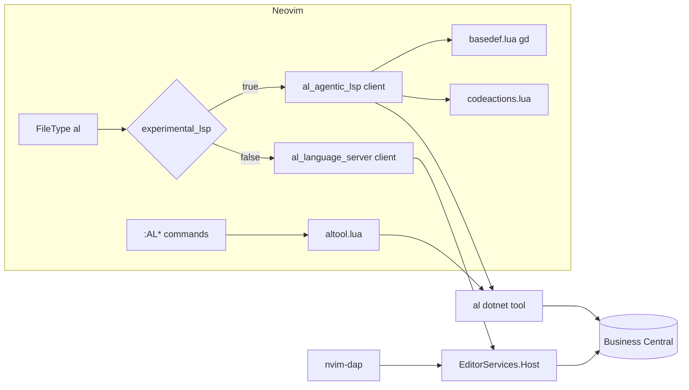
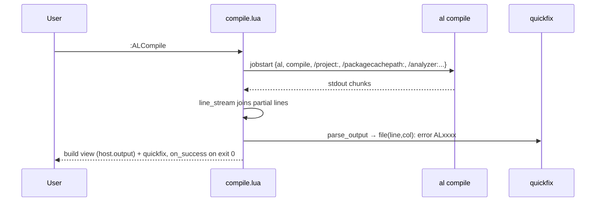
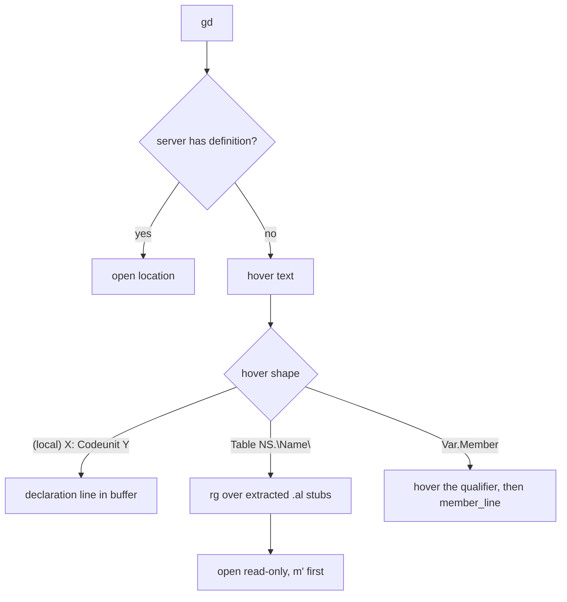

# ALNvim — engineering handbook

> Business Central AL development in Neovim, with the AL dotnet tool as the only toolchain.
> **The compiler is the referee and the `al` tool is the only hand that holds it.**

This handbook answers *why ALNvim has this shape*. The quick reference for keys and
commands is [cheatsheet.md](cheatsheet.md). Agent-facing rules live in
[CLAUDE.md](../CLAUDE.md) and carry the same facts in denser form.

## Document map

| You want to | Read |
|---|---|
| Know if it works and how to start | [Overview](#-overview-) |
| Understand the toolchain split and the data flows | [Architecture](#-architecture-) |
| Debug a feature or change one | [Implementation reference](#-implementation-reference-) |
| Know what breaks when Microsoft ships a new tool or extension | [Maintenance](#-maintenance-) |
| Know what came from where | [Provenance](#provenance) |
| Look up a key or command | [cheatsheet.md](cheatsheet.md) |
| Set up the Pi agent on a machine | [pi-setup.md](pi-setup.md) |

---

# ═══ Overview ═══

## Status

| Area | Status | Evidence |
|---|---|---|
| Compile, publish, symbols, tests through the `al` tool | 🟢 live | Clean build with no VS Code extension installed, tool 30.0.42, 2026-10 |
| Agentic LSP (`al launchlspserver`) | 🟢 live, the author's backend since 2026-10-01 | Formatting and base symbols probed on tools 18.0.37 and 30.0.42. Warm-up on attach: first `Cust.` after "ready" in 20–56 ms, 2026-11-22 |
| EditorServices LSP (VS Code extension) | 🟢 live, default when `experimental_lsp = false` | Code actions need it |
| On-prem debugging with nvim-dap | 🟢 live | Breakpoint hit on BC 27 on-prem, 2026-10-02 |
| `:ALRunTests` | 🟢 live | Verified on `pcp-dev2` (BC 28.5), 2026-11-15 |
| Profiling and snapshot MCP proxies | 🟡 experimental | Tool names from `tools/list`. Stop-response shapes not verified live |
| Lua code actions on the agentic LSP | 🟢 live | 32 tests in `tests/codeactions_spec.lua` |
| Inlay hints | 🟠 pending upstream | Tool 30.0.42 reports `inlayHintProvider = false` |
| Catnip host (`host.lua`): build view per root, no tab switch, every compile path | 🟢 live | `tests/host_spec.lua` against a fake; Catnip's own lifecycle tests and a real-config compile probe, 2026-11-22. Tool output, installer log, location lists and the agent terminal are on it too (W3–W5). DAP output and the profile/preview floats are not |
| Host options: `statusline`, `format_on_save`, per-root status, picker once per directory | 🟢 live | `tests/options_spec.lua`, 2026-11-22. Defaults unchanged; the Catnip config sets nothing yet (requests R1 and Q1) |
| Windows | 🟡 best effort | All OS calls go through `platform.lua`. No CI on Windows |
| GitHub wiki | ⚪ retired 2026-11-15 | Home page points at this handbook |

## What ALNvim achieves

- ✅ Edits, compiles, publishes and tests AL with no VS Code installed. Only the `al` dotnet tool is required.
- ✅ Two language servers behind one plugin. The user picks with one flag.
- ✅ Code actions and refactors that work when the server offers none.
- ✅ Go to definition into symbol packages when the server cannot answer.
- ✅ Tests, docs, profiling and snapshots through tool subcommands that VS Code does not expose as commands.
- ✅ AL MCP servers written per project for Claude Code, never into the global settings file.
- ✅ One test suite with no dependencies. 356 cases run under `nvim --headless -u NONE`.
- ✅ Every file-system and process call goes through one platform module, so Windows fixes land in one place.

## Quick start

1. Install Neovim 0.11 or later and ripgrep.
2. Install the AL dotnet tool:

   ```bash
   dotnet tool install -g microsoft.dynamics.businesscentral.development.tools
   ```

3. Add the plugin to `init.lua`:

   ```lua
   vim.pack.add({ { src = "https://github.com/drs76/ALNvim" } }, { load = true })
   require("al").setup({ experimental_lsp = true })
   ```

4. Open an `.al` file in a folder with an `app.json`.
5. Run `:ALDownloadSymbolsGlobal`.
6. Run `:ALCompile`.

NOTE: `vim.pack.add` loads `plugin/` files during `init.lua` only when you pass `{ load = true }`.

NOTE: To use code actions from the Microsoft server, leave `experimental_lsp` at `false` and run `:ALInstallExtension`.

## Design principles

1. **The `al` tool is the toolchain.** Every AL operation except formatting and interactive debugging spawns `altool.binary()`. There is no fallback to the extension. See EN-1.
2. **Fail loudly on a missing tool.** A missing binary gives `altool.missing_msg()`, which names each path it searched. A silent fallback built the wrong app once. See EN-1.
3. **One resolver per external thing.** One function finds the tool, one finds the extension, one builds project references, one names a file. Copies drifted every time.
4. **Platform code lives in one file.** `lua/al/platform.lua` owns paths, chmod, browser, zip and stderr redirection.
5. **The editor never blocks on a search.** Symbol-package searches go through `explorer.rg_async`. The one synchronous reader is `completefunc`, which caches.
6. **Per project, never global.** The plugin writes MCP entries, cop selections and browser choices under the project.
7. **Every fix ships with a test that fails on the old code.** A test that passes both ways documents nothing. See EN-9.

## Lessons learned — engineering notes

**EN-1 — No extension fallback.** Compile fell back to the extension's `alc`, publish fell back to the DAP adapter and then to a direct HTTP POST. On a Windows laptop with no tool, that produced a build with the wrong compiler and a publish that crashed. Both fallbacks are gone. Guard: `tests/altool_spec.lua` "reports the tool missing instead of running the extension's alc" and "errors instead of falling through to the DAP adapter".

**EN-2 — One tool resolver.** Three modules carried their own copy of `~/.dotnet/tools/al`. The copy in `mcp.lua` had no `.exe`, so `:ALMcpSetup` never worked on Windows. `~` is also wrong on a corporate Windows machine. There `$HOME` can point at a network drive while `dotnet tool install -g` writes under `%USERPROFILE%`. Guard: `tests/altool_spec.lua` "on Windows, finds %USERPROFILE%\.dotnet\tools\al.exe when HOME points elsewhere".

**EN-3 — Bounded root search.** `vim.fs.root()` walks to the file-system root. One stray `app.json` at `/mnt/rojaws` made every project on that share resolve to the mount point. AL Explorer then indexed 77k objects in 14s instead of 9.5k in 0.3s. `lsp.find_root_upward` stops at the enclosing `.git` directory. Guard: `tests/root_spec.lua` "stops at the repository root rather than taking a stray app.json above it".

**EN-4 — MCP entries are per project.** Until 2026-09-15 the plugin wrote `~/.claude/settings.json`. Eleven entries accumulated, one pointing at a 3.6TB NFS share. Each entry is a language server that indexes that tree in every Claude Code session. Guard: `tests/mcp_spec.lua` "writes into the project, not the global settings file".

**EN-5 — Never overwrite JSON you could not parse.** The reader took one trailing comma in a hand-edited settings file as an empty file and rewrote it with only `mcpServers`. The user's permissions and hooks were lost. `mcp.read_settings` now returns `nil` plus a reason for invalid JSON. Guard: `tests/mcp_spec.lua` "refuses to touch a settings file it cannot parse".

**EN-6 — Job output must be line-buffered.** `jobstart` delivers chunks where the first element continues the previous partial line. Appending chunks split diagnostics across two lines, so they never matched the quickfix pattern. `line_stream` carries the remainder. Guard: `tests/compile_spec.lua` "joins a line split across chunks".

**EN-7 — A scheduled timer callback can run several times after its work is complete.** The 1s startup poll queued one callback per tick while startup work blocked the main loop. Each callback saw ready. Each closed the timer. Each started another analysis. `startup.poll` claims completion once. Guard: `tests/startup_spec.lua` "with a real uv timer, a blocked main loop drains to exactly one on_ready and no error".

**EN-8 — `:ALUpdate` never switches branch.** It ran fetch, `checkout master` and `merge --ff-only` and reported only the last exit code. It could move a feature-branch checkout onto master or claim success after a failed fetch. Since 2026-11-15 it refuses on a dirty tree, a non-master branch or `ALNVIM_DEV`. Guard: `tests/update_spec.lua`, nine cases.

**EN-9 — Prove the test is red.** Each guard above went red when the fix was reverted. [Testing](#testing) lists the traps found that way.

---

# ═══ Architecture ═══

## Core constraint

Microsoft ships AL tooling two ways. The VS Code extension carries a compiler, a language server
with a private protocol and a debug adapter. The `al` dotnet tool carries the same compiler, a
standard LSP, an MCP server and CLI subcommands for publish, symbols, tests and docs. Neither
carries everything:

- The tool has no debugger. Only the extension's adapter can set a breakpoint.
- The tool's LSP has no code actions and no definition into symbol packages.
- The extension's server speaks a private protocol that only VS Code's client knows.

ALNvim therefore uses the tool for every operation, speaks the private protocol only when the
user opts into the extension's server and fills the tool's gaps in Lua.

> 🧭 **The one idea.** The tool is the single source of truth for building and talking to BC.
> The editor adds what the tool lacks, and never substitutes the extension for the tool.

## Capability comparison

| Capability | `al` tool CLI | `al launchlspserver` | Extension LSP | Extension DAP | ALNvim Lua |
|---|---|---|---|---|---|
| Compile | ✅ `compile` | ❌ | ❌ | ❌ | runs the tool |
| Publish | ✅ `publishapp` | ❌ | ❌ | ✅ as part of launch | runs the tool |
| Symbols | ✅ `downloadsymbols` (30+) | ❌ | ✅ private request, removed | ❌ | runs the tool |
| Formatting | ❌ | ✅ | ✅ | ❌ | ❌ |
| Hover, completion on base symbols | ❌ | ✅ | ✅ | ❌ | ❌ |
| Definition into symbol packages | ❌ | ❌ | ✅ `al-preview://` | ❌ | ✅ `basedef.lua`, hover driven |
| Code actions | ❌ | ❌ | ✅ | ❌ | ✅ `codeactions.lua`, `fixes.lua` |
| Breakpoints, step | ❌ | ❌ | ❌ | ✅ | config only |
| Tests | ✅ `runtests`, `listtests` (30+) | ❌ | ✅ private | ❌ | runs the tool |
| Profiling, snapshots | ✅ MCP proxies (30+) | ❌ | ✅ private | ❌ | one-shot MCP client |
| MCP for Claude Code | ✅ `launchmcpserver` | ❌ | ❌ | ❌ | writes the entry |

## Figures



*Figure 1 — Process map. Every command reaches BC through the tool. Only the opt-out LSP and the debugger spawn the extension host.*



*Figure 2 — A build. Line framing happens before parsing, see EN-6. `publish.lua` chains `al publishapp` on `on_success`.*



*Figure 3 — `gd` on the agentic LSP. The server answers for project procedures. Hover resolves everything else, see [Go to definition](#go-to-definition-basedeflua).*

## What ALNvim is not

- Not a debugger. It configures nvim-dap to run the extension's adapter.
- Not a BC administrator. It cannot unpublish or uninstall an app. The tool has no such subcommand and the dev API has no such route.
- Not a formatter. Both servers format. The plugin only calls them on save.
- Not a VS Code port. The private EditorServices protocol is supported, not reproduced.

## Glossary

| Term | Meaning |
|---|---|
| the tool | The AL dotnet tool, `al`, package `microsoft.dynamics.businesscentral.development.tools` |
| the extension | `ms-dynamics-smb.al-<version>` under `~/.vscode/extensions` or `~/.vscode-insiders/extensions` |
| agentic LSP | `al launchlspserver`, a standard LSP shipped in the tool, client name `al_agentic_lsp` |
| EditorServices | The extension's language server, client name `al_language_server` |
| symbol package | A `.app` in `.alpackages` that holds metadata and, usually, `.al` stubs |
| CRS naming | `src/<type>/<Name>.<Suffix>.al`, spaces removed, no object ID |
| cops | Microsoft code analyzers: CodeCop, PerTenantExtensionCop, UICop, AppSourceCop |
| proxy | `al launchprofilingmcpproxy` or `al launchsnapshotmcpproxy`, a stdio MCP server |

---

# ═══ Implementation reference ═══

## Module layout

Thirty-nine modules under `lua/al/`. The table in [CLAUDE.md](../CLAUDE.md#structure) lists each
one with its public functions. The groups:

| Group | Modules |
|---|---|
| Toolchain | `altool`, `ext`, `platform`, `install`, `update` |
| Project | `lsp` (root, app.json, probing paths), `connection`, `ids`, `project`, `namespace` |
| Build and deploy | `compile`, `publish`, `symbols`, `tests`, `mcp`, `profile`, `debug` |
| Language | `agentic_lsp`, `basedef`, `codeactions`, `fixes`, `refactor`, `textobj`, `snippets`, `ghost` |
| Scaffolding | `wizard`, `layout`, `cops` |
| UI | `host` (the only module that knows about Catnip), `explorer`, `diff`, `actions`, `status`, `preview`, `help`, `agent`, `startup` |

## The tool (`altool.lua`)

`M.binary()` tries `~/.dotnet/tools/al[.exe]`, then `%USERPROFILE%\.dotnet\tools\al.exe` on
Windows, then `exepath("al")`. `M.has(subcmd)` gates features on tool version. Tool 30 added
`downloadsymbols`, `runtests`, `listtests`, `doc` and the two proxies. `M.run()` streams output
into a float through the same `line_stream` as the compiler. `M.mcp_call()` is a one-shot MCP
client over stdio for the older `al_downloadsymbols` route and for the proxies.

`connection_flags(cfg)` maps a `launch.json` configuration to `--server`, `--serverinstance`,
`--tenant`, `--environmenttype`, `--environmentname` and `--authentication`.
`connection_flags(cfg, { port = "mcp" })` emits the API port instead of the dev port. See
[sharp edge 6](#sharp-edges).

UserPassword credentials travel as `BC_SERVER_USERNAME` and `BC_SERVER_PASSWORD` in the child
environment through `cred_env(cfg)`. They never appear in arguments.

## Two language servers

Both attach on `FileType al`. `plugin/al.lua:101` reads `experimental_lsp` and starts one of them.

**EditorServices** speaks a private protocol. Four facts cost the most time:

1. Wrap `al/setActiveWorkspace` as `{ currentWorkspaceFolderPath, settings }`. Top-level fields deserialise silently to nothing, and `al/gotodefinition` then returns `projectId = null`.
2. Send it once per client. Each send restarts indexing.
3. `assemblyProbingPaths` must be a JSON array, never null. Null crashes the server with `ArgumentNullException("path")`.
4. `al/activeProjectLoaded` is a request. The handler must return `vim.NIL`.

Completion items arrive with `label = { label = "begin" }`. nvim-cmp calls `client:request`
directly, so the fix is a patch on `client.request`. Both clients use the same one,
`lsp.patch_completion(client)`. It also removes the quotes from a `filterText` that is only the
bare label in quotes (label `Abs`, filterText `"Abs"`). The tool's server quotes every
filterText, and nvim-cmp then ranked bare names low.

**Agentic LSP** needs only the tool and `.alpackages`. Probed on 2026-10-01 on tools 18.0.37 and
30.0.42 with identical results: formatting and base symbols work, `codeActionProvider` is absent,
`textDocument/definition` fails for anything in a symbol package and for local variables.

The server loads symbols on the first semantic request, which takes 6–9 s. `agentic_lsp.warm`
sends a hover and a member completion when a client attaches, and sets "ready" when the
completion answers or after 30 s. The target must be a real file with a member access (`X.`).
A completion at (0,0) leaves the first `Cust.` at 1 s, and a document that is not on disk gets
empty answers. The VimEnter anchor `_al_startup_.al` is not on disk, so the warm-up opens the
first project file that has a member access for the server only (`didOpen`, then `didClose`).
The server sends no `textDocument/publishDiagnostics`. Diagnostics come from the `alc` pass.

Features must not key on a client name. `lsp.client(bufnr)` returns the attached AL client, whichever it is. Format-on-save once looked up the EditorServices name only, and switching backends
stopped formatting with no message.

## Go to definition (`basedef.lua`)

Figure 3 shows the flow. Details that matter:

- Object names match fully quoted or bare, then a boundary. With both quotes optional, `"Sales Header"` also matched `"Sales Header Archive"` and rg's unordered output decided which one opened.
- The name is the last *quoted* segment. `Microsoft.Purchases.Document."Purch. Header"` has a dot inside the quotes.
- NuGet symbol packages ship without `.al` source. Extraction stamps `0` and `gd` notifies instead of jumping.
- First search per package extracts its sources synchronously, about 8s for Base Application. `explorer.pending_extracts` gates a one-time notice.

Guard: `tests/basedef_spec.lua`, 19 cases.

## Compile (`compile.lua`)

`al compile /project:<root> /packagecachepath:<cache> /analyzer:<dll>...` plus
`/assemblyprobingpaths:` per directory from `lsp.assembly_probing_paths`. Analyzer DLLs come
from the tool's `.store`, never from the extension.

Relative paths in diagnostics resolve against the cwd captured at build time, not the project
root, because `alc` inherits Neovim's cwd. `push_diagnostics` sets `code` and `source = "alc"`
so quick fixes can key on the rule. `analyze_diagnostics` bumps a generation counter per call, so
a cancelled job's `on_exit` cannot reset the namespace.

The output view comes from `host.output`: a Catnip view under Catnip, the bottom split
otherwise. One view per project root (`alnvim.build:<root>`). Callers do not choose the view,
so publish, tests and debug compile into the same one. A second compile of a root stops the
first job. Its late output is dropped by the same generation guard.

## Publish, symbols, tests

- **Publish** is `al publishapp` only. Send `forceUpgrade: true` from launch.json as `--forceupgrade`. The CLI does not read the key, and `:ALPublish` ignored it until 2026-11-14.
- **Symbols** use the CLI on tool 30 and the MCP tool on older versions. Output streams live because AAD sign-in prints a device code mid-run.
- **Tests** discover offline with `al listtests --appfile` and run with `al runtests <id> --raw`. `--testmethods` is a string array, so the flag repeats per method. When any test fails, the whole summary arrives on stderr behind `Test run failed: ` and the totals must come from the last summary line. Guard: `tests/tests_spec.lua` "strips the stderr 'Test run failed:' prefix from the first summary line".

## Debugging (`debug.lua`)

The adapter needs `/startDebugging` and `/projectRoot:<root>`. Without the first it waits in LSP
mode. `breakOnError` must be a boolean, the .NET deserialiser rejects `"All"`. On Linux and macOS the plugin forces `launchBrowser` to `false`, because the adapter's `xdg-open` call aborts the process, and opens the browser itself. Windows on-prem requires `true`.

On-prem UserPassword debugging works since 2026-10-02 because the adapter's deployment DLL reads
`BC_SERVER_USERNAME` and `BC_SERVER_PASSWORD` from its environment. On Windows the full
environment is rebuilt plus those two, because a non-nil env replaces the child's environment.
Guard: `tests/debug_spec.lua` "on Windows, inherits the full environment plus the credentials".

## MCP for Claude Code (`mcp.lua`)

`configure(root)` writes `<project>/.claude/settings.json` with key `al:<basename>` and args
`launchmcpserver ... <root>`. The last positional argument is the server's workspace, so a wrong
root is a server indexing the wrong tree. With `mcp = { profiling = true, snapshot = true }` it
also writes `al-profiling:<name>` and `al-snapshot:<name>`, both on the API port. Writes go
through `al.json.write`, which indents. `vim.deep_equal` skips an unchanged write because
`LspAttach` calls it on every attach. Tool 30.0.42 exposes 13 MCP tools.

## Wizard and file organiser (`wizard.lua`)

Eighteen object types. `build_path` and `organise_file` derive the CRS path independently and
must stay in step. `organise_file` runs on every `BufWritePost` and only acts on files at the
root or under `organise_dirs`, default `src`. Before 2026-11-15 it acted on every AL file, so the
first save in an Agent-template project moved `app/Setup/MyAgentSetup.Table.al` into
`src/table/`.

## Code actions (`codeactions.lua`, `fixes.lua`, `refactor.lua`)

The agentic LSP has no `codeActionProvider`, so `vim.lsp.buf.code_action` did nothing. The
registry holds Lua actions. `pick()` requests `textDocument/codeAction` only when the client
advertises the capability. Otherwise the request waits forever and the Lua actions never show.
Quick fixes key on `diagnostic.code` of the cursor line. Pure refactors take and return string
arrays and return `(nil, reason)` on refusal. `mask_strings` blanks quoted spans first, so
`Rec.Name := 'a := b';` converts correctly.

## Testing

```bash
tests/run.sh
```

437 cases across 32 spec files. Runs under `nvim --headless -u NONE` with only the repo on the
runtime path. Tests reach pure internals through `M._test` on each module. That table is for
tests only.

Traps found while proving tests red:

- A `.alpackages` fixture cannot test the package-cache filter. `glob("**/*")` never enters dot directories. Use a non-dotted cache name.
- Derive cursor columns from the fixture string. A hard-coded column points at the wrong character after an indentation change.
- Stub the fallback you prove is not taken. `altool_spec` fakes a present extension, otherwise the "no fallback" test passes with the fallback restored.
- Record every call, not the last one. A bad path and a good path both ended at `top`, so a last-value assertion passed with the bug restored.
- Fakes share state the way the real module does. `debug.lua` registers DAP listeners once per session. One fake per file.
- Absent must be absent. `-u NONE` keeps `~/.config/nvim` on the runtime path, so the real Catnip loads. A failing `package.preload` entry hides it.
- Run fake timers after the events, not inline. An inline `defer_fn` fired the 5s browser fallback before the `al/openUri` that arrives at 0.5s.

## Sharp edges

Each entry: what happened, why, how to avoid it, which test guards it.

1. **Duplicate files after save.** `sanitise_name` replaced spaces with `_`, so a hand-named `PrivateGallerySetup.Page.al` gained a twin `Private_Gallery_Setup.Page.al` on `:w`. CRS removes spaces. Fixed 2026-11-15. Guard: `tests/wizard_spec.lua` "removes spaces from the object name — never replaces them with _".
2. **Two objects, same ID.** `wizard.write_and_open` uses `vim.fn.writefile`, which fires no autocommands, so the used-ID cache was not dropped. Call `ids.invalidate()` after any write the plugin does itself. Guard: `tests/misc_spec.lua` "next_id sees a file written since the last call, once invalidated".
3. **`end else begin` swallowed the else branch.** Counting all `begin` on a line before all `end` nets that line to zero. Scan tokens in source order and start the forward walk after the opening token. Guard: `tests/textobj_spec.lua` "stops at 'end else begin' from inside the if-branch".
4. **Package-cache filter never matched.** `string.find` with `plain = true` matched `"%.alpackages"` literally. Harmless for the dotted default, wrong for any configured cache name. Guard: `tests/misc_spec.lua` "excludes a non-dotted package cache named by packagecachepath".
5. **Debug flags read `nil`.** The declaration of `_want_browser` sat below the function that used it, so inside that function it was a global. The debugging-context URL never opened and the first breakpoint test failed. Declare module locals at the top. Guard: `tests/debug_spec.lua` "opens the adapter's debugging-context URL once, not the fallback too".
6. **Proxy on the wrong port.** The proxies take the API/OData port, default 7047, not the dev port 7049 that every other command uses. A proxy given 7049 starts cleanly and then fails every call. Guard: `tests/altool_spec.lua` "defaults the on-prem port to 7047 instead of the dev port".
7. **Rename picked the wrong span.** Scanning left for the nearest quote pairs a closing quote with the next string's opening quote. `Cust.Get("Foo"); Other("Bar")` yielded `); Other(`. Pair delimiters left to right. Guard: `tests/refactor_spec.lua`.
8. **Extension version compare.** Two `version_gt` copies existed. One scanned every digit run in a path, so digits in the home directory decided the result. The shared one reads the version tail or a bare string and refuses anything else. Guard: `tests/misc_spec.lua` "compares numerically, not lexically".
9. **Re-download of a 700 MB VSIX.** `install()` tested only the install-target directory, not where the extension already lived. Every "is it installed" check scans both `~/.vscode` and `~/.vscode-insiders`. Guard: `tests/install_spec.lua`.
10. **`require("al")` from `ext.lua`.** `al/init.lua` seeded a default from `al.ext`, which read config back from `al`. Result: "loop or previous error loading module 'al'" and no plugin. `ext.lua` reads `package.loaded["al"]` instead.
11. **AL1075 on every new project.** The scaffold emitted `showMyCode` beside `resourceExposurePolicy`. Microsoft's templates carry only the second. Guard: `tests/project_spec.lua`.
12. **"Ready" before the symbols load.** The agentic client set "ready" in `on_attach`, but the server loads symbols on the first request. The first `.` waited 6–9 s and nvim-cmp stopped waiting after 500 ms, so it showed snippets only. A warm-up at (0,0) or on the VimEnter anchor did not help: the first is not a member completion, and the anchor is not on disk. Guard: `tests/warmup_spec.lua`.
13. **Locked labels.** `extract_label` emitted `Locked = true` unconditionally, so every extracted label left translation. The default is unlocked since 2026-11-15. Guard: `tests/refactor_spec.lua`.
14. **Compile moved the user to another tab.** The build view had one id. Catnip's `View:open` focuses a view that is already open, and when that view is in another tab the focus switches the tab. Close the view in the other tab first. Guard: `tests/host_spec.lua` "compiling from tab B while the view is open in tab A stays in tab B".
15. **Two builds in one view.** The same id served every project, so a second build cleared the first while its job still ran. Key the view and the state by root, and stop the old job of the same root. Guard: `tests/host_spec.lua` "two roots compile into two views; neither clear hits the other".
16. **A private front end in a public default.** `:ALCompile` warned about a missing Catnip on every build for every other user, and publish, tests and debug still opened the bottom split under Catnip. The host adapter now selects the view, detects Catnip once and says nothing. Guard: `tests/host_spec.lua` ":ALCompile without Catnip (D3)" and the three "(D4)" cases.
17. **The host's statusline disappeared in AL buffers.** The ftplugin set a window-local `statusline`. With one global line (`laststatus=3`) the current window's local value is the one drawn, so the host's line was replaced. `setup({ statusline = false })` sets nothing. The status itself was one table for the session, so two projects showed the same one. It is now keyed by root. Guard: `tests/options_spec.lua` "statusline = false leaves the window-local statusline empty" and "each buffer shows its own project's state".
18. **No way to stop format on save.** The ftplugin formatted on every write. `setup({ format_on_save = false })` turns it off. Guard: `tests/options_spec.lua` "format_on_save = false sends no formatting request".
19. **The project picker on every command.** With several projects under the cwd, `get_root` called `inputlist()` each time, and a headless start blocked on it. It now asks once per working directory and never without a UI. Guard: `tests/options_spec.lua` "(D8)".
20. **Commands and docs drifted apart.** Commands were added without an entry in the command list or in ALActions, and aliases stayed after their reason was gone. A test now compares the CLAUDE.md list with the registered commands. Guard: `tests/actions_spec.lua` "CLAUDE.md lists exactly the registered :AL* commands".
21. **`:ALRunTests!` never ran.** `local kind, id = decl and parse_obj_header(decl)` keeps only the first return value of the call, so `id` was always nil. Use an `if` when a call returns more than one value. Guard: `tests/views_spec.lua` "failed tests fill quickfix and open the navigator under Catnip".
22. **The installer log was lost on `:q`.** The installer entered its float, and the float's buffer was wiped when it closed. It now uses a host view that keeps its buffer and does not take focus. Guard: `tests/views_spec.lua` ":ALInstallDotnetTool logs without entering the window".
23. **One more agent per `:ALClaude`.** Each call added a split and started a new agent. One terminal is kept per command and project. Guard: `tests/views_spec.lua` "a second :ALClaude reuses the terminal".

## Worked example — a typical day on an on-prem project

1. Open `src/page/CustomerListExt.PageExt.al`. The agentic LSP attaches and `mcp.configure` writes the project's MCP entry if it changed.
2. Type `Cust.` and get base table fields from `.alpackages`.
3. Press `gd` on `"Sales Header"`. The server has no answer, hover names the table, rg finds the stub, the file opens read-only.
4. Press `<leader>aca` on a procedure header. Lua actions list. Pick "Add publishers". The buffer gains `OnBefore...` and `OnAfter...` events.
5. Save. `organise_file` keeps the file where it is because the name already matches.
6. Press `<leader>ab`. `al compile` streams into the panel. A diagnostic line opens the file at the column on `<CR>`.
7. Press `<leader>at`. `al listtests` reads the built app, the picker shows codeunits, `al runtests --raw` streams results and failures land in quickfix.
8. Press `<F5>`. The adapter publishes with credentials from its environment and opens the browser with the debugging context. A breakpoint in `OnOpenPage` stops.

---

# ═══ Maintenance ═══

## When Microsoft ships a new `al` tool

- Run `al --help` and diff the subcommand list against `altool.has` callers. New subcommands are features, removed ones are breakages.
- Re-probe `launchlspserver` capabilities. `:ALInfo` prints `codeActionProvider` and `inlayHintProvider`. If either turns true, the Lua layer should defer to the server for that feature.
- Run `tools/list` on `launchmcpserver` and both proxies. Update the tool-name table in [CLAUDE.md](../CLAUDE.md#profiling-and-snapshot-proxies-lualprofilelua).
- Capture `al runtests --raw` output on a real server and compare with the fixture in `tests/tests_spec.lua`. The format came from decompilation once and changed on first contact.
- Check the analyzer DLL path under the tool's `.store`. `compile.analyzer_dll` expects `tools/net8.0/any/`.

## When Microsoft ships a new VS Code extension

- Check the layout. Native builds carry `bin/<platform>/alc`, dotnet builds carry `bin/alc.dll`. `ext.layout` must recognise it or selection falls back to an older install.
- Grep `Microsoft.Dynamics.Nav.Deployment.dll` for `BC_SERVER_USERNAME`. If it disappears, on-prem debugging loses its credential path.
- Diff `templates/*/altemplate.json` and the snippet files listed in `package.json`. Both load at runtime, so new ones appear without code changes.
- Diff `extension.js` around `activeWorkspaceClosure` for payload changes to `al/setActiveWorkspace`.

## When Neovim changes

- `vim.pack.add` semantics for `load`.
- `vim.lsp.util` normalisation of `\r\n` in formatting edits, which the agentic LSP sends.
- `vim.wait(…, { fast_only = true })`, which the startup timer test relies on.

## When a BC server version changes

- Symbol availability on Microsoft's NuGet feed lags GA. A project on an unreleased `application` version fails global download with "Exact version not found".
- The adapter reports a breakpoint as `reason = "Step"` on BC 27. Treat as a hit.

---

# Provenance

| Piece | Origin |
|---|---|
| Syntax highlighting | Derived from the extension's `alsyntax.tmlanguage` |
| Snippets | The extension's own files at runtime, plus 12 ALNvim snippets in `snippets/al.json` |
| Project templates | The extension's `templates/` at runtime, plus a built-in Hello World |
| Compiler, LSP, MCP, CLI | Microsoft's `al` dotnet tool, unchanged |
| Debug adapter | The extension's `EditorServices.Host` in `/startDebugging` mode |
| EditorServices protocol | Read from `extension.js` and the LSP log, see [CLAUDE.md](../CLAUDE.md#inspecting-the-al-extension-protocol) |
| Code action ideas | `davidfeldhoff.al-codeactions`, re-implemented on regex and hover because its syntax tree is not available |
| `bc_dark` colours | VS Code's Business Central Dark theme |
| Everything under `lua/al/` | Written for this plugin |

Repository: https://github.com/drs76/ALNvim. First commit 2026-03-26. Written 2026-11-15 against tool 30.0.42, extension 30.0.2863738 and Neovim 0.13.0-dev.
